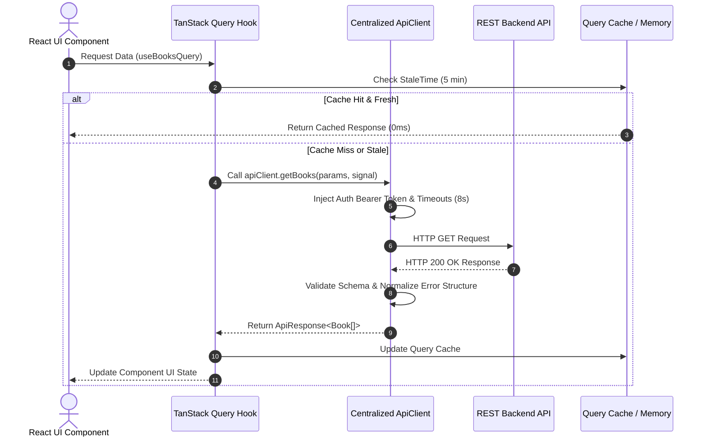

# Enterprise API Architecture & Data Engine v150

## 1. REST API Standards
- Base URL: `https://api.bookverse.com/v1`
- Protocol: HTTPS / TLS 1.3
- Content-Type: `application/json`
- Timestamps: Standard ISO 8601 (`2026-07-31T00:35:44Z`).

---

## 2. Centralized Request Pipeline Architecture



---

## 3. Standardized Response & Error Contracts

### Success Envelope (`ApiResponse<T>`)
```json
{
  "success": true,
  "data": [],
  "meta": {
    "page": 1,
    "limit": 120,
    "total": 120,
    "timestamp": "2026-07-31T00:48:00.000Z"
  }
}
```

### Normalized Error Envelope (`ApiError`)
```json
{
  "code": "REQUEST_CANCELLED",
  "message": "The request timed out after 8000ms.",
  "status": 408,
  "details": {},
  "timestamp": "2026-07-31T00:48:00.000Z"
}
```

---

## 4. Server-State & Caching Policy (TanStack Query)
- **Stale Time**: 5 Minutes (300,000ms).
- **Garbage Collection (gcTime)**: 30 Minutes.
- **Request Deduplication**: Automatic deduplication of identical concurrent requests across components.
- **Retry Policy**: Exponential backoff (max 3 retries for queries; 404 errors skipped).
- **Optimistic Updates**: Instant progress state mutations with background synchronization.
