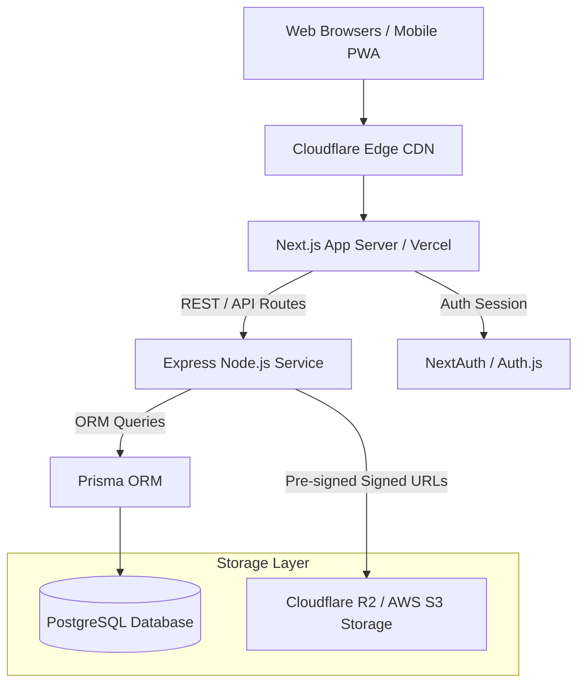

# System Architecture

## Architecture Diagram

---

## Service Boundaries
1. **Frontend (Next.js)**: SSR pages, catalog discovery, client-side EPUB/PDF reader engine, state management.
2. **Backend Services (Express + Prisma)**: Authentication API, book management, user reading progress API, search services.
3. **Storage (Cloudflare R2 / S3)**: Book assets (`.epub`, `.pdf`), cover image media files.
4. **Database (PostgreSQL)**: User accounts, book metadata, reading logs, bookmarks, and categories.
